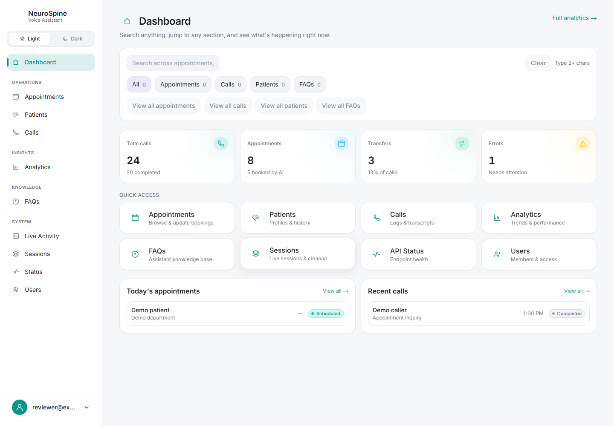
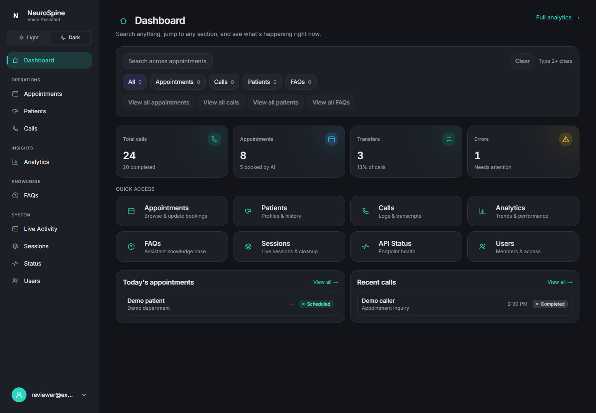

# NeuroSpine voice-assistant dashboard

A Next.js operations frontend for reviewing calls, appointments, patients,
analytics and activity from a separately operated clinic voice-assistant API.
This repository includes the dashboard, login/setup screens and a marketing
landing page; the Express API and voice runtime are separate projects.



**Status and evidence:** these captures show the real local production frontend
with synthetic responses supplied by a browser fixture. Counts, patient/caller
labels and the reviewer account are examples. They do not establish a live
clinic deployment, successful phone calls or verified production integrations.
Marketing-page adoption, performance and compliance claims are unverified.

## What is implemented here

- Dashboard overview, recent calls/appointments and search across operational data.
- Pages for patients, appointments, call details, analytics, FAQs, sessions and users.
- Live activity UI with SSE, polling fallback and a scripted demo-feed option.
- Light/dark themes and browser-local UI preferences.
- A same-origin API proxy. Login responses supply an HttpOnly cookie; the proxy
  forwards it as a bearer token and forwards abort signals for streamed requests.
  Protected proxy calls without a cookie are rejected before reaching the backend.
  The backend must still validate tokens and enforce permissions.

The [proxy](app/api/backend/[...path]/route.ts),
[API helper](lib/backend.ts) and [activity source factory](lib/logs/sources.ts)
show these boundaries. Frontend and voice/backend contributions should be
reviewed separately; existing Git history and credits are retained.

## Run locally

Verified on Windows with Node.js 24.11.1 and npm 11.6.2. The lockfile pins
Next.js 16.1.6 and React 19.2.3; the UI uses TypeScript, Tailwind CSS 3, GSAP and
Zustand. Google font downloads require network access during the build.

```sh
git clone https://github.com/boyInShadows/voiceassist_dashboard.git
cd voiceassist_dashboard
npm ci
npm run dev
```

Open <http://localhost:3000> for the public landing page. Dashboard access
redirects to login. The default backend address is `http://localhost:4001`;
set the server-side `BACKEND_BASE_URL` environment variable before starting
Next.js if your separately provisioned development API uses another address.
Use a disposable backend account and synthetic records. No backend credentials,
database or telephony services are included here; keep secrets out of project files.

```sh
npm run lint
npm run typecheck
npm run build
npm start
```

**Mock mode is partial.** `NEXT_PUBLIC_DATA_SOURCE=mock` changes client API path
normalization, but does not switch the proxy to the bundled `/api/mock` routes
or provide mock authentication. It is not a complete backend-free dashboard.
`NEXT_PUBLIC_LOG_SOURCE=mock` selects the scripted activity feed only. Public
`NEXT_PUBLIC_*` values are embedded at build time and must never contain secrets.



## Verified limits

On 2026-10-30, a clean locked install, typecheck and production build passed.
Lint exited zero with six existing warnings; build reported the deprecated
middleware convention and old Browserslist data. Browser checks verified the
unauthenticated redirect, a real protected-proxy 401, then dashboard rendering
and theme switching with intercepted synthetic login/data responses. Those
intercepted requests do not verify real backend login, persistence, SSE or
voice/provider integrations. There is no frontend test script or hosted quality CI.

Mobile dashboard usability, full role enforcement and a complete security or
accessibility audit remain unverified. A dated npm audit reported 16 dependency
advisories (1 critical, 11 high, 3 moderate, 1 low); dependencies were not upgraded.
The existing capability guide is linked
in [FRONTEND_CAPABILITIES.md](FRONTEND_CAPABILITIES.md); its broader page coverage
is separate from this bounded verification. Existing ownership and asset rights
remain unchanged; no license or certification is assigned by this README.
